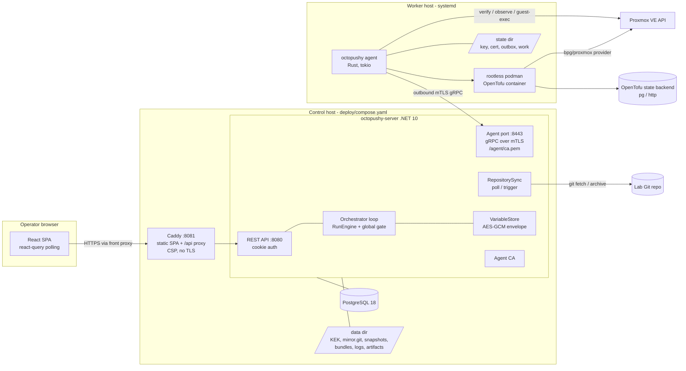
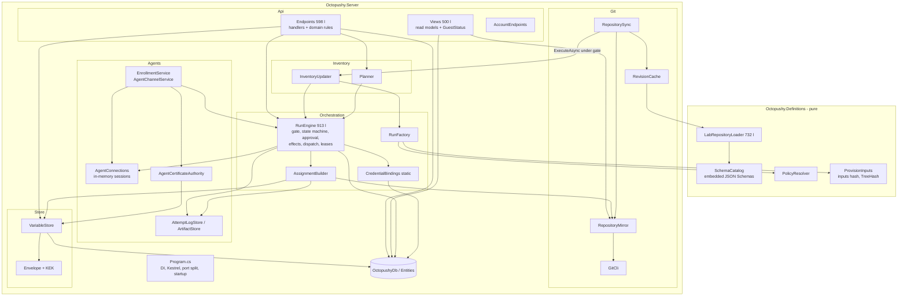
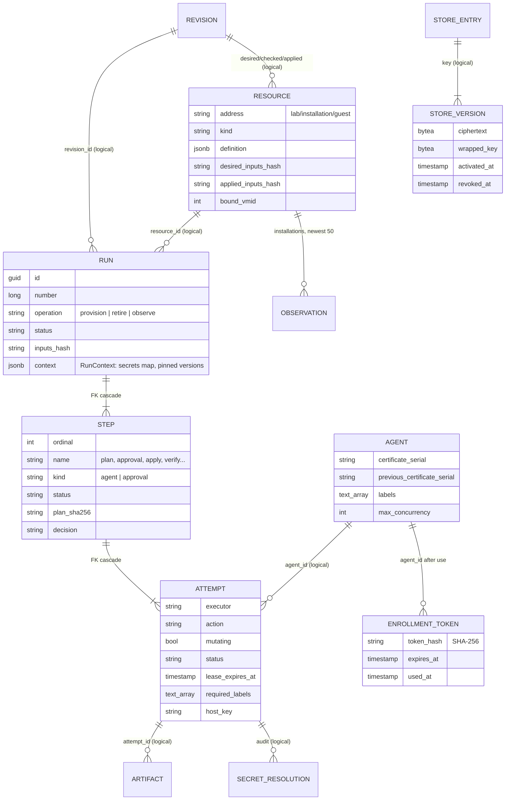
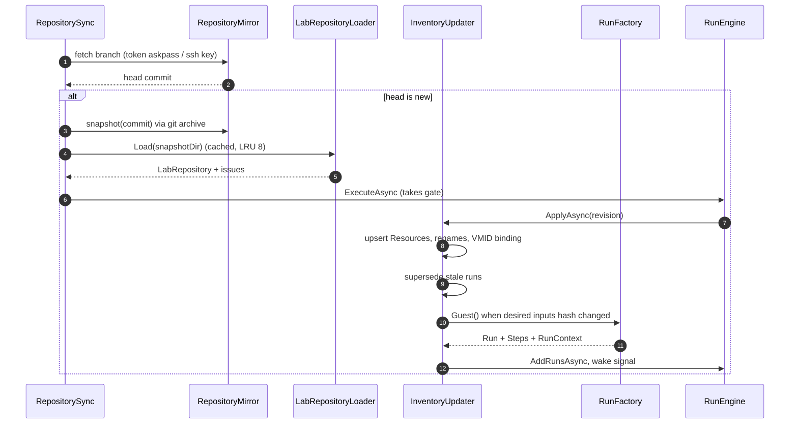
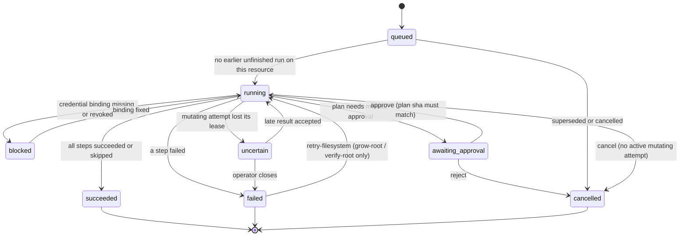
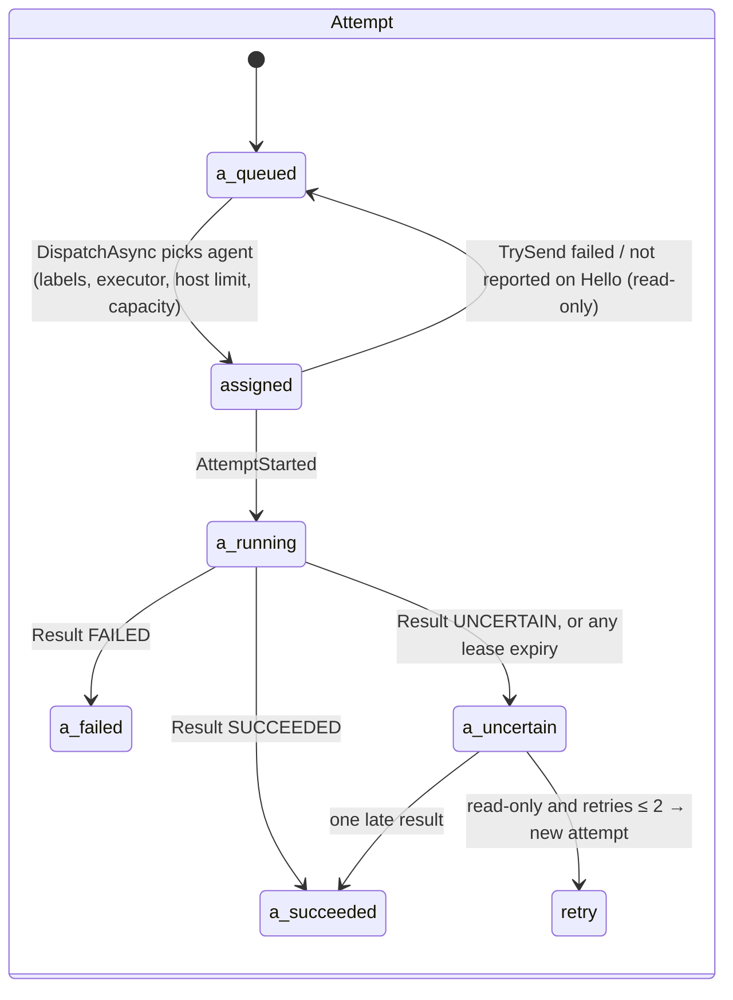
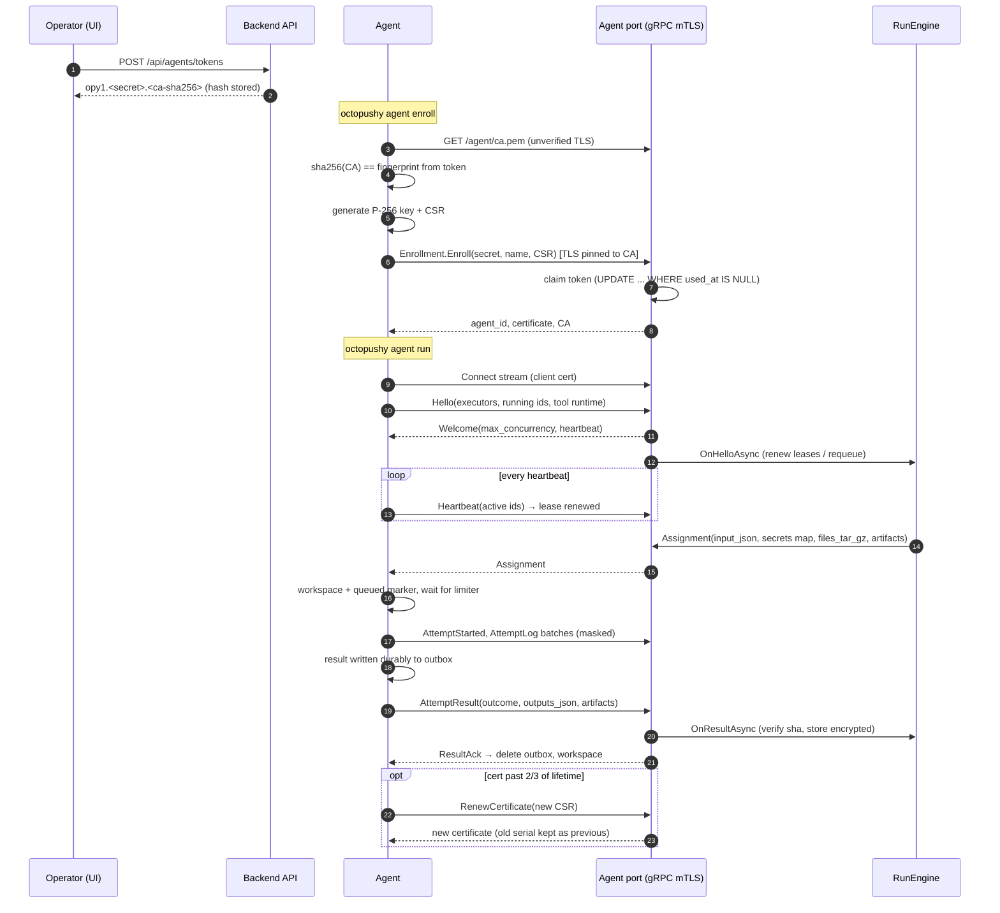
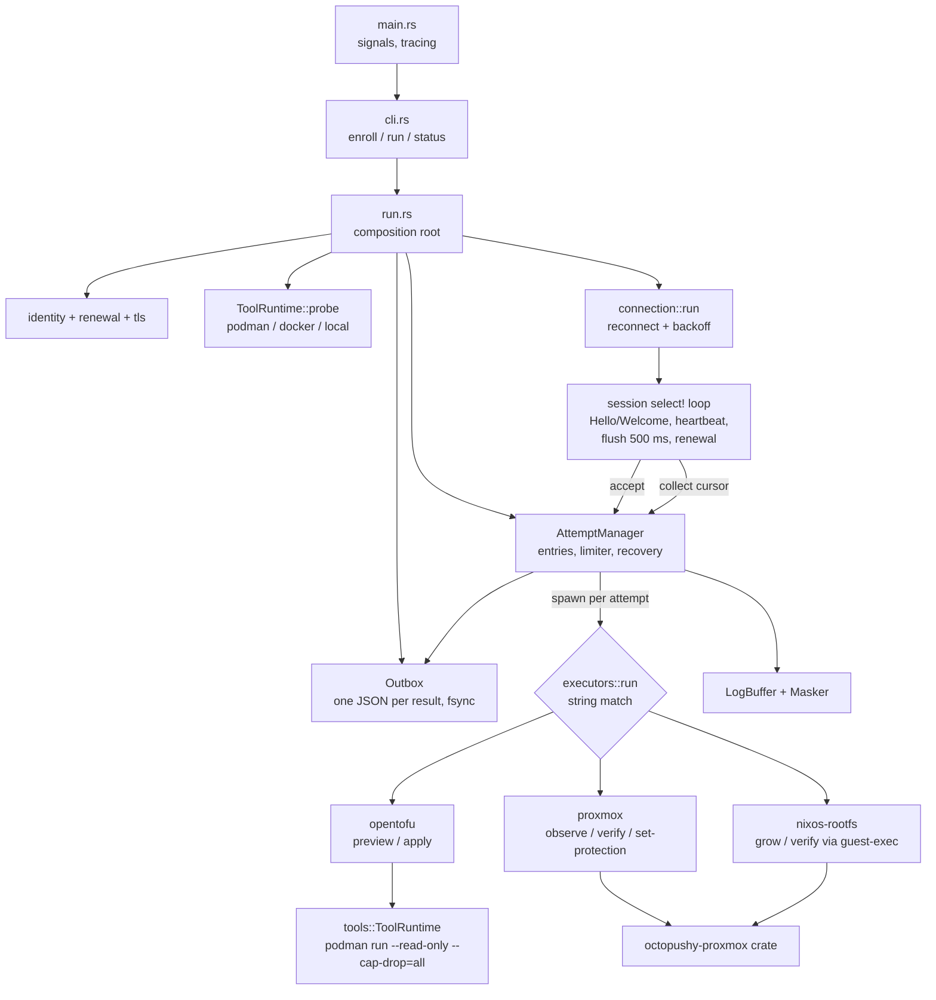
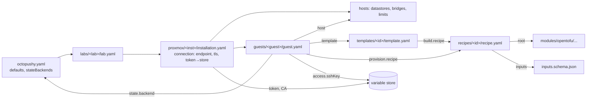

# Current implementation: architecture diagrams

Snapshot: **October 21, 2026**, working tree on `proxmox-e2e` (on top of `cce0ee4`,
including the uncommitted credential-lifecycle, networking, and `nixos-rootfs` work).
These diagrams describe what the code does today, not the target design. The
target design is in [foundations-plan.md](foundations-plan.md).

## 1. System and deployment

The agent always dials out. The server never connects to workers, Proxmox, or guests.
Git is read-only: the server fetches, snapshots, and bundles commits for agents.

## 2. Backend modules as they are today

Almost everything that changes runs, steps, or attempts goes through one in-process
`SemaphoreSlim` in `RunEngine` (two partial files, 525 + 388 lines), including git
bundling, artifact writes, heartbeats, and variable mutations. Agent deletion and
repository settings are written outside it. That gate is the main coupling point.

A lease expiry marks the attempt `uncertain` whether or not it was mutating; only a
mutating one makes the step and run `uncertain`, while a read-only one gets a new attempt.
Only an `uncertain` *mutating* attempt blocks targeted filesystem retry (`RunEngine.cs:129`); a read-only one that lost its agent does not.

## 3. Data model

Only `Step → Run` and `Attempt → Step` are real foreign keys; every other line is a
logical reference (a Guid or string with no constraint).

## 4. From Git commit to runs

## 5. Run and step lifecycle

Steps of a provision run: `plan → approval → apply → verify [→ grow-root → verify-root]`.
A retire run uses `plan(destroy) → approval → unprotect → apply → verify-absent`.

## 6. Agent protocol

## 7. Agent internals

Attempts never write to the connection. They fill a `LogBuffer` or the outbox and wake
the session, which pulls messages through a per-connection `SessionCursor`, so every
reconnect replays started markers, retained logs, and unacknowledged results.

## 8. Lab repository model

Policy (`approval`, `destructive`) and `execution.agentLabels` cascade
`octopushy.yaml → lab → installation → guest`; the nearest setting wins.
