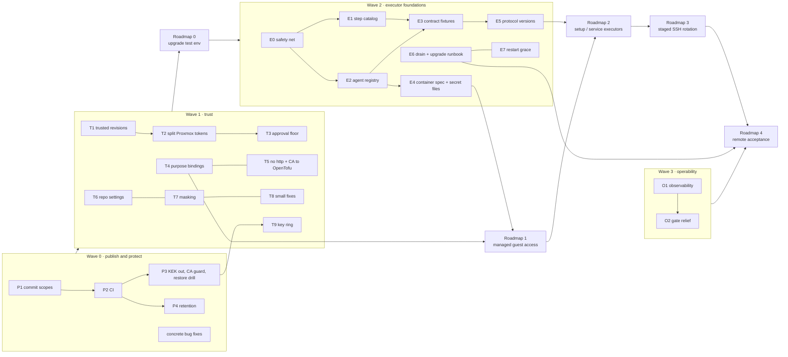

# Foundations plan: refactor, hardening, and the road to remote lifecycle

Snapshot: **October 21, 2026** (revision 2, after an independent review of revision 1).
Inputs: [current architecture](current-architecture.md), [security review](security-review.md)
(F1–F24), and [progress and next steps](../progress-and-next-steps.md). This is a proposed
sequence, not authorization to deploy, rotate credentials, or change machines. It keeps
the six rules in *progress and next steps* and adds the rules in section 2.

**Progress note (October 23, 2026):** this review snapshot remains historical.
The fixes/implementation were published in PR #1, hosted baseline CI in PR #3,
and the synthetic matched-recovery rehearsal in PR #4; all three are merged.
PR #5 is also merged and implements manual T1 (since replaced by [installation trust](../installation-trust.md)), not
signed-commit automation or the whole trust wave. The current
[T2 routing foundation](../proxmox-credentials.md) separates credential roles,
but source inspection found a provider refresh permission blocker; live/full
read-only lifecycle acceptance remains blocked. The remaining trust,
transport and secret-delivery prerequisites still precede guest SSH expansion
and a retained-environment upgrade.

**What changed from revision 1.** The review showed that revision 1's "Wave 1" did not
close the main exfiltration path: the plan step already runs repository-chosen code with
the token before any approval, and observe runs send the token automatically. Revision 2
moves a real closer (trusted revisions + split Proxmox tokens + purpose bindings) ahead of
the roadmap-0 upgrade, cuts the refactor to what roadmap steps 1–2 need, and adds
protocol versioning, drain-based upgrades, backup/CA disaster recovery, and retention,
which revision 1 missed.

## 1. Assessment

**Keep** — these are the system's real strengths:

- Clear process boundaries: a pure `Octopushy.Definitions` library, a server that never
  dials out to workers, agents that pull work over outbound mTLS.
- Honest execution semantics: plan → approval → exact-plan apply → independent verify;
  `uncertain` as a first-class outcome; leases; a durable outbox with replay; one late
  result accepted; dispatch commits **before** handing off (`RunEngine.Agents.cs:125-137`).
- Crypto and identity primitives (see *Done right* in the security review).
- Test depth on the state machine, credential lifecycle, gRPC, and masking.

**Fix** — what limits the next steps:

| Area | Problem | Why it matters next |
|---|---|---|
| Trust model | Repository-chosen code runs at plan time with the privileged token; observe sends it automatically; any store key can be used as the token; any web session can repoint the repository (F1, F2, F17–F19) | Roadmap 1 adds SSH private keys, routed the same way |
| Disaster recovery | One data-dir backup plus the DB decrypts everything; a missing CA is silently re-created; no retention (observe alone ≈105k runs per installation per year) (F21, F22) | Roadmap 0 upgrades a retained environment with a forward-only migration |
| Version skew | `Hello` advertises executors, not actions or contract versions; `agent_version` is recorded but never checked; old agents ignore unknown input fields | Roadmap 4 is the first separately installed agent; roadmap 2 adds actions |
| Executor extensibility | Agent: three string tables and a `tofu`-shaped `ToolRuntime`. Server: step knowledge in `RunFactory`, `AssignmentBuilder`, `StepNames`, `ApplyEffectsAsync` | Roadmap 2 adds setup/service executors on both sides |
| Executor contract | Prose only; C# builds `JsonObject`s, Rust parses its own structs | Every new action risks silent drift |
| Restart behaviour | Lease expiry after a controller restart marks every in-flight attempt `uncertain` (read-only ones no longer block the filesystem retry); server masking is lost | Roadmap 4 exercises controller restart |
| Secret delivery | Env vars only (F10), agent outputs unmasked (F7) | Roadmap 1 requires file delivery |
| Delivery | No CI; ~70 files uncommitted | Nothing protects the refactor |

**Concrete bugs** (small, independent of any refactor). **Fixed on October 22, 2026**, in
the working tree and not yet committed; each has a test that fails without the fix:

- Agent: an unreadable workspace marker was classified `Failed` even for an apply; it is
  now `Uncertain` (`recovery.rs`). A recovered attempt whose stored result is later
  unreadable is also `Uncertain` rather than `Failed` (`attempts/mod.rs`).
- Server: read-only lease expiry marked the attempt `uncertain`, which permanently blocked
  `RetryFilesystemAsync`. Only an uncertain *mutating* attempt blocks it now
  (`RunEngine.cs`); the attempt DTO carries `mutating` so the UI applies the same rule.
- Agent: a transport error, undecodable reply, or 5xx after the `set-protection` PUT was
  `Failed`; it is `Uncertain` now, while rejections (401, 403, 4xx) stay `Failed`
  (`proxmox.rs`).
- Server: CA initialization refuses to create a new CA while any agent or enrollment token
  exists (F21). A half-written first start, with nothing depending on it, is redone.
- F22 is only partly closed: the server warns at startup when the key is inside the data
  directory, and `deploy/README.md` says what each backup holds. Moving the key out by
  default is still open (T9/P3); see the follow-ups below.

**Follow-ups found while verifying those fixes** (a second model reviewed each change):

- Server: an agent-reported `Uncertain` for a *read-only* attempt (now possible after an
  unreadable marker) parks the run until an operator closes it, while a lease expiry of the
  same attempt would retry it. The server should apply the read-only retry policy using its
  own `attempt.Mutating` (`RunEngine.Agents.cs`, result handling).
- CA bootstrap is not atomic and not safe against two replicas starting at once: the key
  and certificate are separate writes (startup now detects a key that does not match its
  certificate and redoes or refuses it) and both replicas can pass the empty-installation
  check. The design is single-process today; a PostgreSQL advisory lock around
  initialization, or one combined store entry, closes it.
- Refusing to start with the key in the data directory (outside Development) is the real
  F22 fix, but it breaks any retained install that relies on the default path. Decide it
  together with the roadmap-0 upgrade. The startup warning is lexical and misses a
  symlink that puts the key inside the data directory.

## 2. Rules added to the existing six

7. **Trusted revisions only.** No secret-bearing step runs for a commit the operator has
   not marked trusted (or whose signature the server has not verified).
8. **Privilege follows approval.** Read-only credentials for observe, verify, and plan;
   mutating credentials are released only to an approved apply or mutation step.
9. **The repository proposes; the server binds.** Each secret has a purpose and a
   destination bound server-side. Git may narrow where a secret goes, never widen it.
10. **Approval is not decided by the party being approved.** Whether a plan needs a human
    cannot depend only on fields the planning agent controls.
11. **One backup must not decrypt everything.** The KEK lives outside the data directory
    and its backup, with an offline escrow copy.
12. **No refactor without a semantic safety net.** Behaviour-preserving changes land only
    with CI green and the characterization tests in section 3 passing.
13. **Do not "simplify" these:** run-level `uncertain` stays non-terminal (late results
    depend on it); dispatch keeps commit-before-send; mutating attempts stay immune to
    cancellation.

## 3. Work items

### P: Publish and protect

- **P1 Commit the working tree in coherent scopes** (networking, credential lifecycle,
  `nixos-rootfs`, worker readiness, examples, tests, docs). Exclude `.dev/` and private
  state. *Done when:* each commit builds alone and the tree is clean.
- **P2 CI** on every push: `dotnet test`, `cargo test`, `cargo fmt --check`,
  `cargo clippy -D warnings`, `npm test`, `npm run lint`, `tsc -b`, Python tests,
  `nix flake check --no-build`, an OpenAPI drift check (regenerate and fail on diff), and
  dependency audits (`cargo audit`, `dotnet list package --vulnerable`, `npm audit`).
- **P3 Backup and disaster recovery.**
  - Move the KEK out of the data directory (systemd credential or a separate mounted
    file) with an offline escrow copy; refuse a KEK inside the data dir unless explicitly
    allowed (F11, F22).
  - CA guard (F21) and a written CA rotation / re-enrollment runbook.
  - Restore drill into a scratch environment. Expected result, stated up front: agents
    that renewed their certificate after the backup cannot reconnect and must re-enroll.
  - *Done when:* a restore shows the same runs and decryptable variables, and the agent
    outcome matches the stated expectation.
- **P4 Retention.** Prune old observe runs aggressively (keep the last N and any failed
  or uncertain); keep runs tied to the applied revision and anything unresolved; cap
  logs and artifacts by age; keep `SecretResolution` rows as long as the runs they explain.

### T: Trust (closes F1, F2, F4, F17–F20 before the upgrade)

- **T1 Trusted revisions.** A revision becomes eligible for secret-bearing work only when
  the operator marks it trusted in the UI (one click, shows the diff since the last
  trusted revision), or when its commit signature matches a server-side allowed key list.
  Observe and plan use the newest trusted revision. Untrusted revisions still load,
  validate, and show their proposed runs as *waiting for trust*.
- **T2 Optional split Proxmox credentials.** Updated October 24, 2026: installation
  `connection.token` explicitly selects one shared token. This homelab option
  releases its full upstream permissions during planning; trust/apply approval
  is not a sandbox and does not provide the credential separation proposed here.
  Alternatively, omit `token` and configure distinct
  `readOnlyToken` (observe, native verify, plan) and `privilegedToken` (apply,
  unprotect, grow-root **and verify-root**) references. The privileged role is
  released only after the existing approval gate; manual no-op rootfs runs retain
  a saved plan for that gate. No automatic legacy-role conversion or privileged
  planning fallback. **Source blocker found:** bpg 0.117.0 disk/EFI refresh can
  require mutation-capable storage/VM permissions; strict read-only
  update/destroy planning is not universally supported. Do not “fix” that by
  widening the planner role. Resolve provider compatibility before live acceptance.
  [Research and candidate scopes](../research/proxmox-credential-split.md) are
  not a certified ACL recipe; pool-only scopes do not cover every phase.
  State-backend credentials remain necessary at plan time and can permit writes
  during initialization/workspace creation, so T1 remains essential.
- **T3 Approval floor.** A server-side minimum policy the repository can only tighten
  (stored in the database, changed only after password re-authentication). Under a
  manual policy, approval is required whenever `hasChanges` is true or a plan artifact
  exists (F4). The approval view shows the planning agent, plan hash, and the commit diff
  of the root module and recipe since the last applied revision.
- **T4 Purpose and destination bindings** (lean version of revision 1's grants). Each store
  key gets a purpose and one binding, keyed by key, not version, so rotation needs no
  re-grant:
  - `proxmox-token` → endpoint host:port + CA fingerprint + required agent labels;
  - `ssh-key` → guest addresses (for roadmap 1);
  - `backend-env` → env variable name.

  One server-wide list of allowed OpenTofu image digests; token-bearing work is refused on
  `local` runtimes (F20). Agent label edits require re-authentication. A migration
  proposes bindings from current runs; the operator confirms them on one screen; runs
  with unconfirmed bindings block with a visible reason.
- **T5 Transport.** Refuse `http://` for token-bearing endpoints and credentialed Git URLs
  (F3, F12), together with passing the CA into the OpenTofu container and supporting
  `tls.fingerprint` pinning (F3), so refusing `http` does not push installations to
  `verify: false`. Update the example lab and `tests/proxmox` to verify TLS.
- **T6 Repository settings.** Clear the Git credential when scheme/host/port changes;
  re-authenticate for repository changes; configured `known_hosts` instead of `accept-new` (F2, F12).
- **T7 Masking.** Agent masks `outputs_json`; mask after truncation and against sanitized
  forms; add base64/URL-encoded variants; server masking rebuilt from `SecretResolution`
  rows so it survives restarts (F7).
- **T8 Small fixes.** Enrollment token via env or stdin and shorter expiry (F8); renewal
  only within the window and from the current serial (F9); final-mode file creation,
  atomic setup, dummy hash for unknown users (F13); small `Enroll` limits (F15); no
  `{:?}` on server messages (F14); per-batch log ownership (F16).
- **T9 Session key ring** encrypted with the (now separate) KEK; unhide its warning;
  `Secure` cookies when `PublicUrl` is HTTPS (F6). Only meaningful after P3 moves the KEK.

### E: Executor foundations (lean, for roadmap 1–2)

- **E0 Semantic safety net.** These tests must exist before anything below moves:
  1. A replayed result (outbox replay) is idempotent; effects apply once.
  2. A late result from a retried read-only attempt is recorded but does not decide the step.
  3. A crash between the dispatch commit and the send leads to `uncertain` by lease, never
     an automatic redispatch of a mutating attempt.
  4. A `Hello` that omits an attempt requeues only non-mutating `assigned` attempts.
  5. Apply refuses a plan whose hash differs from the approved one, at approval and at
     assignment.
  6. Cancel and supersede are refused while a mutating attempt is active.
  7. Controller restart with leases already expired, including the `verify-root` retry case.
  8. A golden table per step of `(executor, action, mutating, secret names)`, asserted
     equal in C# and Rust.
  9. Agent recovery: every running mutating action and every unreadable marker becomes
     `Uncertain`; mutating attempts ignore cancel.
  10. A golden podman argv test: no secret values in argv, and all hardening flags present
      (`--log-driver=none`, `--read-only`, `--cap-drop=all`, `no-new-privileges`, `keep-id`).
- **E1 Step catalog (server).** One table: step → executor, action, mutating, secret
  purposes, effect handler, retry policy. `RunFactory`, `AssignmentBuilder`, and
  `ApplyEffectsAsync` read from it. The `mutating` flag is security-relevant (a wrong
  flag makes an apply retryable); test 8 guards it.
- **E2 Executor registry (agent).** `trait Executor` with `ActionSpec { name, mutating }`,
  `probe`, `run`, and its own config. `Assignment` gains a `mutating` field; the agent
  uses `server_flag || local_flag` and records it in the marker.
- **E3 Executor contract fixtures.** Golden input/output JSON for every new action and for
  `opentofu preview/apply`, deserialized by a C# test and a Rust test. Schemas optional.
- **E4 Container spec + secrets as files.** A minimal `ContainerSpec` (image, entrypoint,
  argv, mounts, secret files, env names, workdir, network) that keeps every current
  hardening flag (test 10). Secrets go to a per-attempt 0700 directory of 0400 files on
  tmpfs (`$XDG_RUNTIME_DIR`, or `/run/octopushy-agent` under systemd), mounted read-only;
  env carries only paths. Startup recovery wipes leftover secret directories (F10).
- **E5 Protocol versioning.** `Hello` advertises `executor/action@contract-version`; the
  server dispatches only to exact matches and records `agent_version`; the supported skew
  is agent N-1; the outbox record carries a format version.
- **E6 Drain and upgrade procedure.** A server drain mode (stop dispatch, let mutating
  attempts finish) and the existing agent drain, plus a written upgrade runbook:
  automatic backup, drain, explicit forward-only migration, start, verify.
- **E7 Restart grace.** After startup, no lease expiry until start + lease + grace; do not
  blanket-extend leases for agents that reconnect without reporting the attempt. Read-only
  expiries no longer block filesystem retry.

### O: Operability before remote acceptance

- **O1 Minimal observability.** Health endpoint with the counts of `uncertain`, `blocked`,
  and lease-expired attempts, queue wait time, agent last-seen, and gate wait time.
- **O2 Cheap gate relief.** Cancels via `TrySend` instead of a 10 s `SendAsync` under the
  gate; one cached bundle per commit. Do more only if O1's gate wait time says so.

### Later (opportunistic, or when the area is touched)

- Split `RunEngine` into a pure state machine, approval policy, effects, and a coordinator;
  thin endpoints; query services replacing `Views`; module registration extensions.
- `xmin` concurrency tokens (only if a second process ever becomes a goal); FK with
  `SET NULL` or soft delete for agents (do this sooner if agent deletion is used).
- Core types without proto in the agent; testable session loop; shared `poll_until`.
- Typed `PlanOutputs`, OpenAPI enums, server-computed `canCancel`/`canRetry`, a single
  source for key/label patterns, frontend tests for untested pages, SSE for logs.
- Real sessions (security stamp, sign-out everywhere, password change); encryption of
  logs and the agent outbox; AEAD context including visibility (F11).
- Egress allowlist for OpenTofu containers; providers baked into digest-pinned images;
  OpenTofu state encryption; short-lived per-run Proxmox tokens.

## 4. Sequence

| Wave | Contents | Gate to proceed |
|---|---|---|
| 0 | P1–P4 (the four concrete bug fixes are done; commit them with P1) | Clean tree; CI required; restore drill matches its stated expectation |
| 1 | T1–T9 | An untrusted commit and an out-of-binding endpoint both block with a visible reason; observe/plan run with the read-only token; e2e passes with TLS verification on |
| → Roadmap 0 | Upgrade one selected test environment | As written in *progress and next steps*, with Waves 0–1 included |
| 2 | E0–E7 | All ten E0 tests pass before and after; a new action needs only catalog + registry + fixtures |
| → Roadmap 1–2 | Managed guest access, then setup/service executors | Roadmap 1 uses T4 (`ssh-key` binding) and E4 (secret files); roadmap 2 uses E1–E3, E5 |
| → Roadmap 3 | Staged SSH rotation | As written |
| 3 | O1, O2 | Gate wait and uncertain counts visible |
| → Roadmap 4 | Remote acceptance | As written, plus the additions in section 5 |

Why this order:

- **CI and a working restore before anything else**, because the tree is the only copy of
  a lot of work and the credential migration is forward-only.
- **Trust before the upgrade.** Upgrading the retained environment as-is keeps an
  automatic, approval-free path from a commit to the Proxmox token. T1 and T2 are the
  controls that actually close it; approval floors and endpoint grants alone do not.
- **Only the refactor that roadmap 1–2 needs.** Splitting `RunEngine`, concurrency tokens,
  and folder moves would churn ~70 uncommitted files for no roadmap benefit; they wait.
- **Versioning and drain before the first separately installed agent**, so upgrades and
  restarts do not manufacture `uncertain` outcomes.

## 5. Changes proposed to the existing roadmap

- **Step 0:** add Waves 0–1 to the upgrade candidate; the upgrade itself follows E6's
  runbook once it exists (drain, backup, explicit migration). Record which security
  findings are fixed, accepted, or deferred.
- **Step 1:** the SSH key is a store key with purpose `ssh-key` bound to guest addresses
  (T4) and is delivered as a file (E4). Add to *done when*: an unbound guest, an agent
  without the bound labels, or a `local` runtime never receives the key.
- **Step 2:** every new action ships with fixtures (E3), a catalog entry (E1), a registry
  entry (E2), and a contract version (E5); the mutating flag is checked equal on both
  sides (E0 test 8).
- **Step 4:** add *TLS verification on everywhere*, *controller down longer than the lease
  window*, *agent one version behind the server*, and *upgrade via the runbook* to the
  acceptance list.
- **Later list:** add egress control, OpenTofu state encryption, and short-lived per-run
  Proxmox tokens as the long-term answers to F17 and F24.

## 6. How to keep improving

- **Decision records.** One short ADR per irreversible choice (trusted revisions, token
  split, binding model, executor contract format, protocol versioning) in
  `docs/decisions/`; the architecture agreement links to them.
- **Living diagrams.** Update `docs/review/current-architecture.md` in the same change that
  moves a boundary; CI can check that every Mermaid block parses.
- **Threat model.** Keep a short document of actors (operator, repository committer, agent
  host, LAN, backup reader), assets, and controls next to `CONTEXT.md`; re-run the
  token-focused review after Wave 1 and again before roadmap 4.
- **Hostile-input tests.** Property or fuzz tests for tar extraction (both sides),
  definition loading, plan-summary parsing, and masking (random secrets in random encodings).
- **Every feature's definition of done:** fixtures and contract version, CI green, docs and
  diagram updated, and an explicit statement of what was *not* verified. The project
  already does that last part well.
